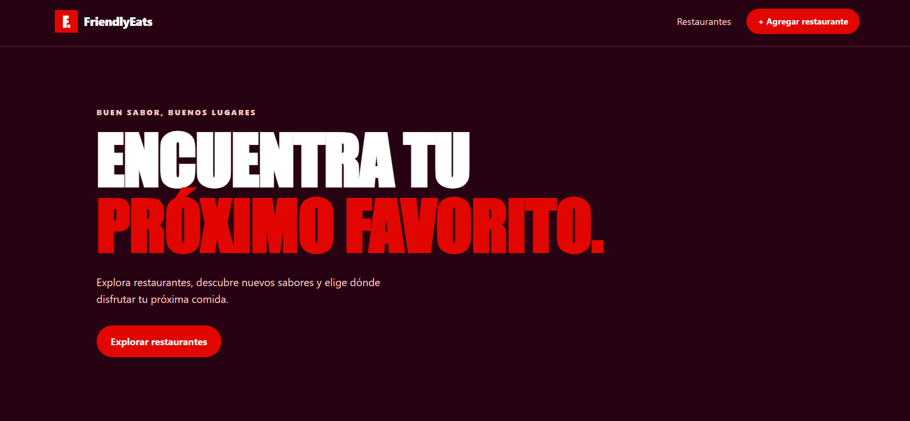
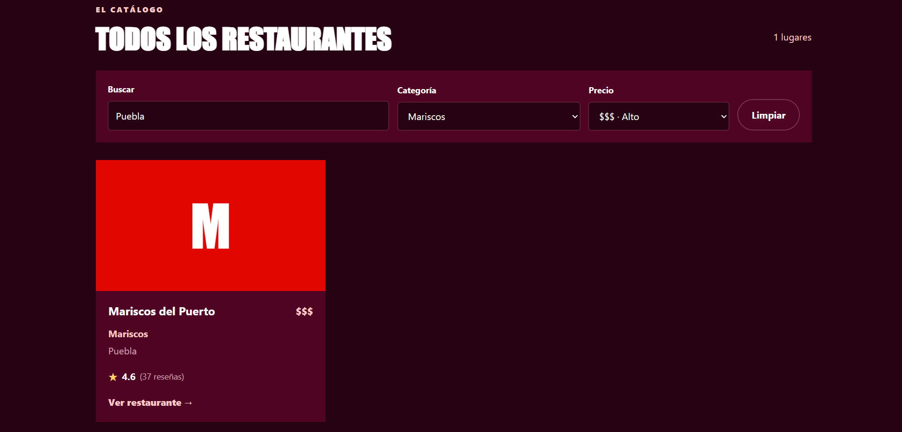
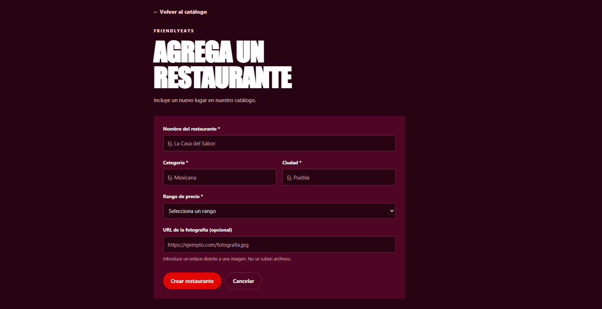
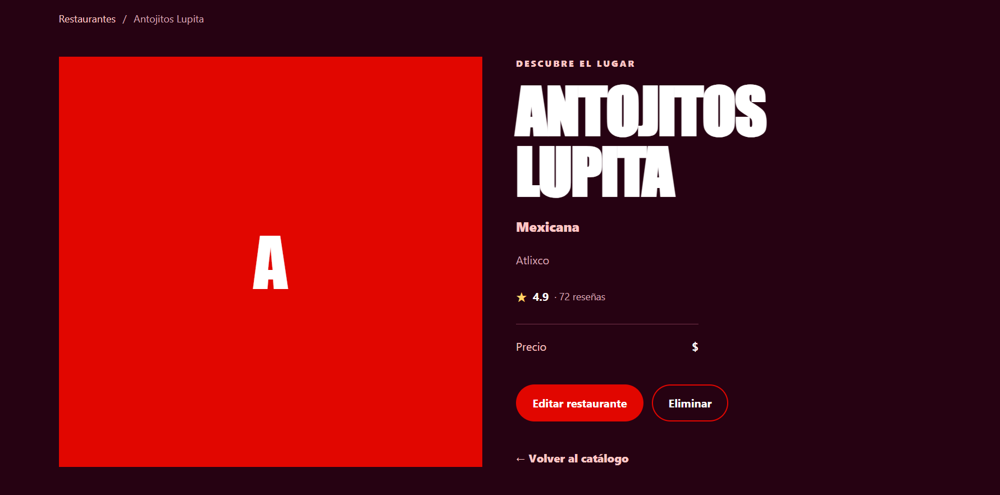
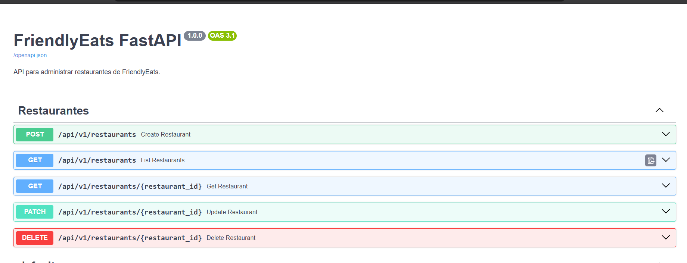

# FriendlyEats FastAPI — Sprint 1

Aplicación web para consultar, registrar, actualizar y eliminar restaurantes. El proyecto utiliza **FastAPI** para el backend, **Jinja2** para las vistas HTML y **Cloud Firestore Emulator** para almacenar los datos durante el desarrollo local.

## Características

- Operaciones CRUD para restaurantes.
- Interfaz web adaptable a diferentes tamaños de pantalla.
- Búsqueda y filtrado por ciudad, categoría y rango de precio.
- Ordenamiento por nombre o calificación.
- Paginación de resultados en la API.
- Validación de datos mediante Pydantic.
- API REST documentada automáticamente con Swagger UI.
- Persistencia local mediante Firestore Emulator.
- Datos de ejemplo para cargar 10 restaurantes.
- Pruebas automatizadas con Pytest.
- Configuración mediante variables de entorno.

## Tecnologías utilizadas

| Tecnología | Uso |
|---|---|
| Python | Lenguaje principal |
| FastAPI | Desarrollo de la API y aplicación web |
| Uvicorn | Servidor de desarrollo |
| Jinja2 | Renderizado de páginas HTML |
| Pydantic | Validación de datos |
| Google Cloud Firestore | Almacenamiento de restaurantes |
| Firebase Emulator Suite | Entorno local de Firestore |
| HTML, CSS y JavaScript | Interfaz de usuario |
| Pytest y HTTPX | Pruebas automatizadas |
| Git | Control de versiones |

## Requisitos previos

Antes de comenzar, instala:

- Python 3.13 o una versión compatible con las dependencias del proyecto.
- Node.js y npm.
- Java compatible con la versión instalada de Firebase CLI.
- Git.
- Firebase CLI.
- Visual Studio Code, recomendado para editar el proyecto.

Comprueba las instalaciones desde PowerShell:

```powershell
python --version
node --version
npm --version
java -version
git --version
firebase --version
```

Si algún comando no funciona, revisa la instalación correspondiente y que esté disponible en la variable de entorno `PATH`.

## Instalación

### 1. Descargar el proyecto

Clona el repositorio:

```powershell
git clone https://github.com/JulioTrini17/friendlyeats-fastapi.git
```

Entra en la carpeta:

```powershell
cd friendlyeats-fastapi
```

### 2. Crear el entorno virtual

```powershell
python -m venv .venv
```

Actívalo:

```powershell
.\.venv\Scripts\Activate.ps1
```

Si PowerShell bloquea la activación por la política de ejecución, puedes utilizar esta alternativa temporal para la sesión actual:

```powershell
Set-ExecutionPolicy -Scope Process -ExecutionPolicy Bypass
.\.venv\Scripts\Activate.ps1
```

### 3. Instalar las dependencias

Con el entorno virtual activado:

```powershell
python -m pip install --upgrade pip
python -m pip install fastapi "uvicorn[standard]" jinja2 python-multipart pydantic-settings google-cloud-firestore firebase-admin pytest httpx python-dotenv
```

### 4. Configurar las variables de entorno

Crea un archivo llamado `.env` en la raíz del proyecto, al mismo nivel que `firebase.json`.

Agrega la siguiente configuración:

```dotenv
APP_NAME=FriendlyEats FastAPI
ENVIRONMENT=local
FIREBASE_PROJECT_ID=demo-friendlyeats
FIRESTORE_EMULATOR_HOST=127.0.0.1:8080
```

Estas variables configuran el nombre de la aplicación, el entorno de desarrollo, el identificador de Firebase y la dirección del emulador.

**Importante:** no publiques el archivo `.env` ni credenciales privadas. El identificador `demo-friendlyeats` se utiliza para desarrollo local.

## Configurar y ejecutar Firestore Emulator

### 1. Revisar Firebase CLI

Si Firebase CLI todavía no está instalado, puedes instalarlo globalmente:

```powershell
npm install -g firebase-tools
```

Comprueba la instalación:

```powershell
firebase --version
```

### 2. Iniciar el emulador

Abre una terminal de PowerShell en la raíz del proyecto y ejecuta:

```powershell
firebase emulators:start --only firestore --project demo-friendlyeats
```

Mantén esta terminal abierta mientras utilizas la aplicación.

Direcciones locales:

- Emulador de Firestore: `http://127.0.0.1:8080`
- Interfaz de administración: `http://127.0.0.1:4000/firestore`

El emulador permite desarrollar y probar sin conectarse a una base de datos de producción. Los datos del emulador no deben considerarse almacenamiento permanente entre reinicios si no se configura su exportación e importación.

## Cargar los restaurantes de ejemplo

Con Firestore Emulator en ejecución, abre una **segunda terminal** en la carpeta del proyecto.

Activa el entorno virtual si es necesario:

```powershell
.\.venv\Scripts\Activate.ps1
```

Ejecuta el script de carga:

```powershell
python scripts/seed_restaurants.py
```

El script registra 10 restaurantes de ejemplo con información de categoría, ciudad, precio y calificaciones.

Puedes consultar los documentos en la interfaz del emulador o desde la aplicación web.

## Ejecutar la aplicación

Con el emulador activo, abre otra terminal y ejecuta:

```powershell
uvicorn app.main:app --reload
```

Accede a la aplicación desde el navegador:

- **Aplicación web:** http://127.0.0.1:8000/
- **Documentación interactiva de la API:** http://127.0.0.1:8000/docs
- **Comprobación del estado:** http://127.0.0.1:8000/health
- **Formulario de registro:** http://127.0.0.1:8000/restaurants/new

Para detener el servidor, presiona `Ctrl + C` en su terminal.

## Endpoints de la API

La API permite administrar los restaurantes mediante los siguientes endpoints:

| Método | Endpoint | Descripción |
|---|---|---|
| POST | `/api/v1/restaurants` | Crear un restaurante |
| GET | `/api/v1/restaurants` | Listar restaurantes |
| GET | `/api/v1/restaurants/{id}` | Consultar un restaurante |
| PATCH | `/api/v1/restaurants/{id}` | Actualizar campos permitidos |
| DELETE | `/api/v1/restaurants/{id}` | Eliminar un restaurante |

### Filtros, ordenamiento y paginación

El endpoint de listado admite filtros por ciudad, categoría y precio, además de ordenamiento y paginación.

Ejemplo:

```text
GET /api/v1/restaurants?city=Puebla&category=Mexicana&price=2
```

Ejemplo de ordenamiento y paginación:

```text
GET /api/v1/restaurants?order_by=avgRating&direction=desc&limit=10&offset=0
```

Los parámetros disponibles se pueden consultar en Swagger UI, en la dirección `http://127.0.0.1:8000/docs`.

## Ejecutar las pruebas

Asegúrate de que Firestore Emulator esté en ejecución y que las variables de entorno estén configuradas.

Desde la raíz del proyecto, ejecuta:

```powershell
python -m pytest tests/test_restaurants_api.py -v
```

Las pruebas verifican el estado de la aplicación y las operaciones principales de la API, incluyendo creación, consulta, actualización y eliminación de restaurantes.

## Estructura del proyecto

```text
friendlyeats-fastapi/
├── app/
│   ├── api/
│   │   └── v1/
│   │       └── restaurants.py
│   ├── core/
│   │   ├── config.py
│   │   └── firebase.py
│   ├── domain/
│   │   ├── models.py
│   │   └── schemas.py
│   ├── repositories/
│   │   └── restaurant_repository.py
│   ├── services/
│   │   └── restaurant_service.py
│   └── main.py
├── scripts/
│   └── seed_restaurants.py
├── static/
│   ├── css/
│   └── js/
├── templates/
├── tests/
│   └── test_restaurants_api.py
├── .gitignore
├── firebase.json
├── firestore.rules
└── README.md
```

La estructura representa las responsabilidades principales del backend, la interfaz, los scripts y las pruebas. Algunos archivos o subdirectorios pueden variar según la versión actual del proyecto.

## Seguridad y buenas prácticas

- No subir `.env` al repositorio.
- No publicar claves privadas ni archivos de cuentas de servicio.
- No utilizar datos de prueba como si fueran datos de producción.
- Mantener las validaciones de entrada en los esquemas de Pydantic.
- Ejecutar las pruebas antes de integrar nuevos cambios.
- Revisar las reglas y la configuración de Firebase antes de desplegar en un entorno real.

## Estado del proyecto

**Sprint 1:** funcionalidades principales del CRUD, interfaz web, conexión con Firestore Emulator, carga de datos de ejemplo y pruebas automatizadas.

## Capturas de pantalla

### Página principal



### Filtros de restaurantes



### Registro de restaurantes



### Detalle de restaurante



### Documentación de la API




## Autor

**Julio Cesar Trinidad Garcaa**

Proyecto académico de desarrollo de software.
